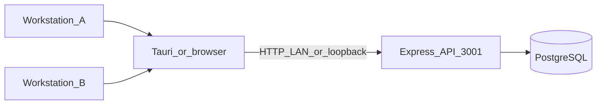

# BizCode Local — deployment topology (#537)

**Purpose:** Operational and architectural topology for **BizCode Local** (distributor program [#535](https://github.com/ayelenleclerc/BizCode/issues/535)): single establishment, multi-workstation, multi-site options, remote channels, and failure modes. Compatible with [ADR-0007](../adr/ADR-0007-dual-deployment-and-fiscal-modularity.md) and [ADR-0029](../adr/ADR-0029-local-deployment-topology.md).

**Related:** [local-distributor-scope-matrix.md](local-distributor-scope-matrix.md) (#536), [architecture.md](../architecture.md), [product-vision-and-deployment.md](product-vision-and-deployment.md), [backup-and-restore.md](backup-and-restore.md), [disaster-recovery.md](disaster-recovery.md), [iam-model-sessions-audit.md](iam-model-sessions-audit.md).

**Baseline tip:** `develop` after merge of #536 (`b9b3d077` lineage).

## Roles in a single establishment

| Role | Responsibility | Evidence / notes |
|---|---|---|
| **Principal host** | Runs PostgreSQL + Express API (`:3001`) for the establishment | `pnpm run server`; `DATABASE_URL`; packaging sidecar → [#539](https://github.com/ayelenleclerc/BizCode/issues/539) |
| **Workstation (puesto)** | UI client (Vite/Tauri webview) against principal API | `VITE_API_URL`; no separate DB by default |
| **Postgres** | Single logical database for the tenant deployment | Prisma one datasource; DR: no automated replica |
| **Operators** | Owner/manager assign users, deposits, RBAC scopes | `AppUser.scopeWarehouseIds` / `scopeBranchIds` (Int arrays; **no** `Branch` model FK) |

## Baseline data flow (single site)

**Runtime note:** [architecture.md](../architecture.md) diagrams show Express as a Tauri sidecar. Current `src-tauri/src/main.rs` only registers `ping`; API is started separately. Treat sidecar as target packaging, not current evidence.

## Multi-site comparison (decision pending)

| Topic | Option A — shared DB | Option B — local DB + sync |
|---|---|---|
| Data ownership | One tenant DB; sites = deposits / scopes | Per-site DB; merge rules TBD |
| Document numbering | Single PV/sequence space (current `ParamEmpresa`) | Collision risk unless partitioned |
| Stock | `StockDeposito` + transfers (#236) in one DB | Requires sync of stock/movements (**Not evidenced**) |
| Consistency | Strong (one Postgres) | Eventual; conflict policy TBD |
| Availability if WAN down | Remote sites lose API if they depend on central host | Local ops may continue; sync backlog |
| Ops cost | VPN/secure link + central backup | N backups + sync ops + conflict tooling |
| Accidental extra DB | Forbidden: workstations are clients only | Risk if each PC installs full stack without policy |

**Owner decision required:** whether the first commercial Local pilot operates **one** establishment or **five** sites, and whether five sites use A or B. This document does **not** unilaterally reduce or expand the pilot.

In-repo today, “sucursal” means a **warehouse type** inside one DB (`Deposito.tipo`), not a separate Local installation.

## Remote channels inventory (regression)

| Channel | In-repo evidence | Needs reachable API? |
|---|---|---|
| Web admin / desktop UI | `apps/web` | Yes (LAN or loopback) |
| Portal B2B (#240) | `/api/portal/:tenantSlug/*`, UI `/portal/:tenantSlug` | Yes (typically public HTTPS) |
| App Seller (#167+) | `apps/seller`; offline outbox → API | Yes to flush |
| App Driver (#159+) | `apps/driver`; offline #164; rendition online | Yes to flush / rendir |
| eCommerce sync (#189) | `EcommerceSyncJob` / connectors | Yes + external marketplaces |
| Inbound webhooks | MP / MeLi / Tiendanube / Woo / Twilio paths; `API_PUBLIC_URL` | Yes (public URL) |

**Local implication:** pure LAN-only API breaks public portal/webhooks unless an edge (reverse proxy, tunnel, or hybrid hosted inbox) is added. Design of a durable public inbox is a **follow-up issue after** topology choice — **Not evidenced** as a finished Local component.

## Failure matrix

| Failure | What still works (baseline single-site) | What stops |
|---|---|---|
| **Principal PC / API host down** | Nothing that needs write/read via API; mobile outbox queues if devices already have cache | All workstations, portal, webhooks, sync workers |
| **LAN down** (API host up) | Loopback users on the principal host | Other puestos; LAN-attached printers/scanners |
| **Internet down** (LAN + API up) | Counter sales, stock, local users, LAN clients | AFIP/live fiscal, marketplace sync, public portal/webhooks, hosted SaaS paths, some FX/jobs |
| **External service down** (AFIP, MP, MeLi, …) | Core Local POS/orders if not blocked on that call | That integration only (mocks remain for homologación where coded) |
| **Postgres down** | Nothing durable | Entire API |

## Security posture (topology-level)

- Authorization remains **server-side** (`requirePermission`, tenant middleware, portal guards).
- Isolation by **tenant** (ADR-0010); warehouse/branch scopes are arrays — fine-grained multi-site IAM may need follow-up.
- Secrets: DB URL, session secrets, webhook credentials must stay on the principal host / secret store — not copied to every puesto.
- Residual risk: exposing Local API to the internet without #538 controls.

## Explicit gaps (Not evidenced)

- Multi-site DB sync / CRDT / conflict resolver
- Automatic principal election
- Five-branch deploy automation
- Implemented Tauri Express sidecar
- Automated DB replica (see disaster-recovery.md)

## Next issues

[#538](https://github.com/ayelenleclerc/BizCode/issues/538) local security → [#539](https://github.com/ayelenleclerc/BizCode/issues/539) installer/sidecar → [#540](https://github.com/ayelenleclerc/BizCode/issues/540) Local backups → sync children **after** multi-site decision.

## Other languages

[Español](../../es/quality/topologia-despliegue-local.md) · [Português (Brasil)](../../pt-br/quality/topologia-implantacao-local.md)
