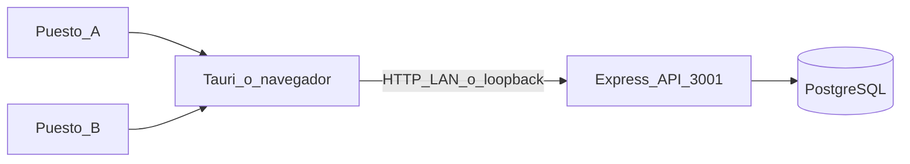

# BizCode Local — topología de despliegue (#537)

**Propósito:** Topología operativa y arquitectónica de **BizCode Local** (programa distribuidora [#535](https://github.com/ayelenleclerc/BizCode/issues/535)): un establecimiento, multi-puesto, opciones multisitio, canales remotos y modos de fallo. Compatible con [ADR-0007](../adr/ADR-0007-dual-deployment-and-fiscal-modularity.md) y [ADR-0029](../adr/ADR-0029-local-deployment-topology.md).

**Relacionado:** [matriz-alcance-local-distribuidora.md](matriz-alcance-local-distribuidora.md) (#536), [arquitectura.md](../arquitectura.md), [vision-producto-y-despliegue.md](vision-producto-y-despliegue.md), [backup-y-restauracion.md](backup-y-restauracion.md), [recuperacion-ante-desastres.md](recuperacion-ante-desastres.md), [modelo-iam-sesiones-auditoria.md](modelo-iam-sesiones-auditoria.md).

**Baseline:** `develop` tras merge de #536.

## Roles en un establecimiento

| Rol | Responsabilidad | Evidencia / notas |
|---|---|---|
| **Host principal** | Ejecuta PostgreSQL + Express API (`:3001`) | `pnpm run server`; sidecar empaquetado → [#539](https://github.com/ayelenleclerc/BizCode/issues/539) |
| **Puesto** | Cliente UI contra el API principal | `VITE_API_URL`; sin DB propia por defecto |
| **Postgres** | Una base lógica del despliegue | Un `DATABASE_URL`; DR sin réplica automática |
| **Operadores** | Usuarios, depósitos, scopes RBAC | `scopeWarehouseIds` / `scopeBranchIds` (arrays; **sin** modelo `Branch` con FK) |

## Flujo baseline (un sitio)

**Nota de runtime:** [arquitectura.md](../arquitectura.md) muestra Express como sidecar Tauri. En código, `src-tauri` solo registra `ping`; el API se inicia aparte. El sidecar es empaquetado objetivo, no evidencia actual.

## Comparativa multisitio (decisión pendiente)

| Tema | Opción A — DB compartida | Opción B — DB local + sync |
|---|---|---|
| Propiedad de datos | Una DB tenant; sitios = depósitos / scopes | DB por sitio; reglas de merge TBD |
| Numeración | Un espacio de PV/secuencia (`ParamEmpresa`) | Riesgo de colisión si no se particiona |
| Stock | `StockDeposito` + transferencias (#236) | Requiere sync (**Not evidenced**) |
| Consistencia | Fuerte (un Postgres) | Eventual; política de conflictos TBD |
| WAN caída | Sitios remotos pierden API si dependen del central | Ops local puede continuar; cola de sync |
| Costo ops | Enlace seguro + backup central | N backups + sync + conflictos |
| DB accidental extra | Prohibido: puestos solo clientes | Riesgo si cada PC instala stack completo |

**Decisión de propietaria:** ¿el primer piloto Local opera **un** establecimiento o **cinco** sitios, y con A o B? Este documento **no** reduce ni amplía el piloto de forma unilateral.

En el repo, “sucursal” como `Deposito.tipo` es almacén **dentro** de una DB, no una instalación Local aparte.

## Inventario de canales remotos (regresión)

| Canal | Evidencia in-repo | ¿Requiere API alcanzable? |
|---|---|---|
| Web admin / desktop | `apps/web` | Sí (LAN o loopback) |
| Portal B2B (#240) | `/api/portal/:tenantSlug/*`, UI `/portal/:tenantSlug` | Sí (típicamente HTTPS público) |
| App Seller (#167+) | `apps/seller`; outbox offline → API | Sí para flush |
| App Driver (#159+) | `apps/driver`; offline #164 | Sí para flush / rendir |
| Sync e-commerce (#189) | `EcommerceSyncJob` / conectores | Sí + marketplaces |
| Webhooks entrantes | MP / MeLi / Tiendanube / Woo / Twilio; `API_PUBLIC_URL` | Sí (URL pública) |

**Implicación Local:** un API solo-LAN rompe portal/webhooks públicos salvo un edge (proxy, túnel o inbox hosted). Inbox durable público = issue de seguimiento **tras** elegir topología.

## Matriz de caídas

| Fallo | Qué sigue (baseline un sitio) | Qué se detiene |
|---|---|---|
| **PC / host API principal caído** | Nada que requiera API; outbox móvil puede encolar | Puestos, portal, webhooks, workers |
| **LAN caída** (host API arriba) | Usuarios en loopback del principal | Otros puestos |
| **Internet caída** (LAN + API OK) | Ventas mostrador, stock, usuarios LAN | Fiscal live, sync marketplace, portal/webhooks públicos |
| **Servicio externo caído** | Core Local si no bloquea esa llamada | Solo esa integración |
| **Postgres caído** | Nada durable | Todo el API |

## Postura de seguridad (nivel topología)

- Autorización **server-side**; aislamiento por **tenant** (ADR-0010).
- Secretos en el host principal / almacén de secretos — no en cada puesto.
- Riesgo residual: exponer API Local a Internet sin controles de #538.

## Brechas explícitas (Not evidenced)

- Sync multi-DB / resolución de conflictos
- Elección automática de PC principal
- Automatización de despliegue a cinco sucursales
- Sidecar Express Tauri implementado
- Réplica automática de DB

## Próximos issues

[#538](https://github.com/ayelenleclerc/BizCode/issues/538) → [#539](https://github.com/ayelenleclerc/BizCode/issues/539) → [#540](https://github.com/ayelenleclerc/BizCode/issues/540); sync **después** de la decisión multisitio.

## Otros idiomas

[English](../../en/quality/local-deployment-topology.md) · [Português (Brasil)](../../pt-br/quality/topologia-implantacao-local.md)
