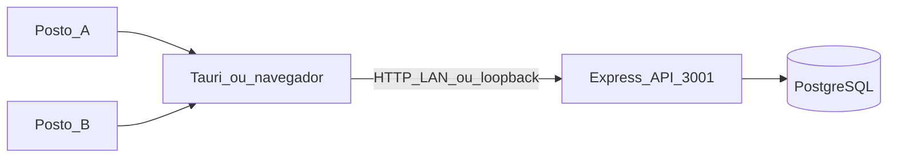

# BizCode Local — topologia de implantação (#537)

**Propósito:** Topologia operacional e arquitetural do **BizCode Local** (programa distribuidora [#535](https://github.com/ayelenleclerc/BizCode/issues/535)): um estabelecimento, multi-posto, opções multi-site, canais remotos e modos de falha. Compatível com [ADR-0007](../adr/ADR-0007-dual-deployment-and-fiscal-modularity.md) e [ADR-0029](../adr/ADR-0029-local-deployment-topology.md).

**Relacionado:** [matriz-escopo-local-distribuidora.md](matriz-escopo-local-distribuidora.md) (#536), [arquitetura.md](../arquitetura.md), [visao-produto-e-implantacao.md](visao-produto-e-implantacao.md), [backup-e-restauracao.md](backup-e-restauracao.md), [recuperacao-de-desastres.md](recuperacao-de-desastres.md).

**Baseline:** `develop` após merge de #536.

## Papéis em um estabelecimento

| Papel | Responsabilidade | Evidência / notas |
|---|---|---|
| **Host principal** | PostgreSQL + Express API (`:3001`) | `pnpm run server`; sidecar → [#539](https://github.com/ayelenleclerc/BizCode/issues/539) |
| **Posto** | Cliente UI contra a API principal | `VITE_API_URL`; sem DB própria por padrão |
| **Postgres** | Uma base lógica da implantação | Um `DATABASE_URL`; DR sem réplica automática |
| **Operadores** | Usuários, depósitos, scopes RBAC | `scopeWarehouseIds` / `scopeBranchIds` (arrays; **sem** model `Branch` com FK) |

## Fluxo baseline (um site)

**Nota de runtime:** a arquitetura documenta Express como sidecar Tauri; o código atual só registra `ping`. O sidecar é empacotamento alvo, não evidência atual.

## Comparativo multi-site (decisão pendente)

| Tema | Opção A — DB compartilhada | Opção B — DB local + sync |
|---|---|---|
| Propriedade dos dados | Uma DB tenant; sites = depósitos / scopes | DB por site; merge TBD |
| Numeração | Um espaço PV/sequência | Risco de colisão |
| Estoque | `StockDeposito` + transferências (#236) | Exige sync (**Not evidenced**) |
| Consistência | Forte | Eventual |
| WAN fora | Sites remotos perdem API se dependem do central | Ops local pode continuar |
| Custo ops | Link seguro + backup central | N backups + sync |
| DB extra acidental | Proibido: postos só clientes | Risco se cada PC instala stack completo |

**Decisão da proprietária:** piloto com **um** estabelecimento ou **cinco** sites (A ou B). Este documento **não** decide unilateralmente.

No repositório, “sucursal” como `Deposito.tipo` é armazém **dentro** de uma DB.

## Inventário de canais remotos (regressão)

| Canal | Evidência | API alcançável? |
|---|---|---|
| Web admin / desktop | `apps/web` | Sim |
| Portal B2B (#240) | `/api/portal/:tenantSlug/*` | Sim (HTTPS público típico) |
| App Seller (#167+) | `apps/seller` + outbox | Sim para flush |
| App Driver (#159+) | `apps/driver` | Sim para flush / rendir |
| Sync e-commerce (#189) | `EcommerceSyncJob` | Sim + marketplaces |
| Webhooks | MP / MeLi / etc.; `API_PUBLIC_URL` | Sim |

## Matriz de falhas

| Falha | O que segue (baseline um site) | O que para |
|---|---|---|
| **Host API principal fora** | Nada via API; outbox pode enfileirar | Postos, portal, webhooks |
| **LAN fora** | Loopback no principal | Outros postos |
| **Internet fora** | Vendas balcão / estoque LAN | Fiscal live, sync, portal/webhooks públicos |
| **Serviço externo fora** | Core Local se não bloquear | Só essa integração |
| **Postgres fora** | Nada durável | Toda a API |

## Postura de segurança (nível topologia)

- Autorização server-side; isolamento por tenant (ADR-0010).
- Segredos no host principal.
- Risco residual: expor API Local sem #538.

## Lacunas (Not evidenced)

- Sync multi-DB; eleição de PC principal; deploy automatizado a cinco filiais; sidecar Express Tauri; réplica automática.

## Próximas issues

[#538](https://github.com/ayelenleclerc/BizCode/issues/538) → [#539](https://github.com/ayelenleclerc/BizCode/issues/539) → [#540](https://github.com/ayelenleclerc/BizCode/issues/540).

## Outros idiomas

[English](../../en/quality/local-deployment-topology.md) · [Español](../../es/quality/topologia-despliegue-local.md)
